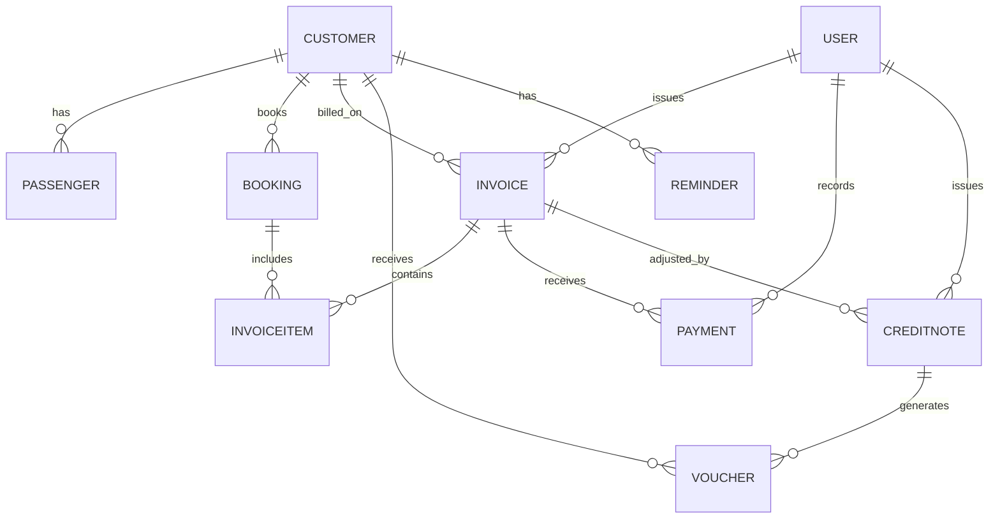
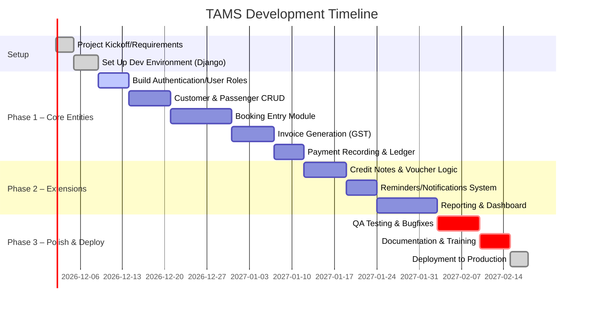

# Executive Summary

A **Travel Agency Management System (TAMS)** for a small team (2–4 agents) is essentially an internal ERP/CRM tailored to travel bookings. It must let agents *manually* record bookings and related transactions, manage customers and passengers, issue invoices with GST, track payments, issue credit notes/vouchers, send reminders, and generate reports – all without external API integration. In practice this means rich CRUD interfaces plus accounting features. For example, under GST law a supplier may issue a credit note to adjust an invoice, which must include fields like the original invoice number and tax values. Django’s built-in features (models, admin, ORM, auth) make it especially fast to build this kind of application: “Django admin… provides a quick, model-centric interface where trusted users can manage content on your site”. PostgreSQL can easily handle the data volume (it supports *unlimited rows per table*). 

Below we detail each major feature (purpose, users/roles, UI, data schema, workflows, validation, permissions, audit logs, notifications, exports) along with its implementation complexity and priority. We also compare using Django vs a Next.js/Node.js stack for each module, draw an ER diagram, propose a phased timeline, and show sample Django models/API endpoints for core entities. Citations from Django documentation, GST regulations, and PostgreSQL confirm key points.

# Features

Each feature/module is listed with **purpose**, **roles involved**, **UI screens and key fields**, **data model**, **workflow** (normal and edge cases), **validation rules**, **permissions**, **audit/logging**, **notifications**, **PDF/export**, and **complexity (Low/Med/High)** and **priority (Must/Should/Can)**.

### Customer Management  
- **Purpose:** Store and manage each client (individual or corporate) who books travel through the agency. Track contact, billing info and balances. Acts as the core CRM entity.  
- **Roles:** Agent (adds/edits customers), Accountant, Admin.  
- **UI Screens:**  
  - *Customer List:* Table of customers (Name, Phone, Email, Company, GSTIN, Outstanding Balance, Loyalty points, etc.) with search and filter by name or phone.  
  - *Customer Detail/Edit:* Form with fields (Name, Phone, Email, Address, GSTIN, Company/PAN if B2B, Notes, etc.). Show aggregated info (total bookings, total paid, total due).  
- **Data Model (DB Table `Customer`):** Fields include `id`, `name`, `phone`, `email`, `address`, `company_name`, `GSTIN`, `PAN`, `customer_type` (Individual/Corp), `created_at`, `created_by`, etc. Also derived fields or related aggregates (total_sales, total_paid) can be computed.  
- **Workflow (Happy Path):** Agent clicks “New Customer”, fills required fields (Name, Phone at minimum), saves. The customer appears in list. For existing customer, edit/update as needed.  
- **Edge Cases:** Duplicate detection (alert if phone/email already exists). Handling walk-in vs corporate: Corporate may have multiple contacts.  
- **Validation:** Name and Phone required; Phone format digits; Email valid format; GSTIN format if given. Enforce unique phone/email if needed.  
- **Permissions:** Agents can create/view all customers (or only their clients if multi-branch, but with 2–4 users likely all see all). Admin has full control. Customer data (especially GSTIN/PAN) is sensitive; log access for compliance.  
- **Audit/Logging:** Record who created/edited a customer and when. (Django’s built-in `updated_at`/`created_at` and user stamping can be used.)  
- **Notifications:** Not typically needed, but one could notify (email/SMS) the customer when created or when any invoices/payments occur.  
- **PDF/Export:** Ability to export customer list or statements as CSV/Excel. Possibly print “Customer Account” statements.  
- **Complexity:** *Low.* Basic CRUD with standard fields.  
- **Priority:** *Must.*

### Passenger Management  
- **Purpose:** Maintain a database of frequent travelers/passengers to avoid retyping their details on each booking (e.g. family members). A single customer may have many passengers.  
- **Roles:** Agent, Admin.  
- **UI Screens:**  
  - *Passenger List:* Shown per customer (or global list filtered by customer). Displays Passenger Name, Age/DOB, Gender, Preferences.  
  - *Passenger Detail/Edit:* Form with fields (Name, DOB, Gender, Aadhaar/Passport, Senior Citizen Y/N, Seat preference, Food preference, etc.).  
  - *Booking Screen Passenger Selector:* In booking UI, allow selecting saved passenger(s) from a customer’s passenger list (checkboxes) or “Add New Passenger”.  
- **Data Model (`Passenger`):** Fields: `id`, `customer_id` (FK to Customer), `name`, `dob`, `gender`, `is_senior`, `food_pref`, `berth_pref`, `id_type` (Aadhaar/Passport), `id_number`, `created_at`.  
- **Workflow:** Agent can pre-load passengers under a customer. When making a new booking, agent clicks “Add Passenger” and selects from existing list (UI shows checkboxes). If a new passenger, agent fills mini-form and saves it. Then continue to booking.  
- **Edge Cases:** Verify date of birth (<100 years old, < 18 or >60 for senior). Ensure same name not duplicated under one customer.  
- **Validation:** Name and DOB required; Aadhaar 12 digits if entered; Passport format if entered.  
- **Permissions:** Same as Customer. Only agents can add passengers for their customers; admin can edit all passengers.  
- **Audit:** Log creation/edit.  
- **Notifications:** None specific.  
- **PDF/Export:** Not needed (tickets/invoice covers passenger info).  
- **Complexity:** *Low.* Slightly more UI, but straightforward.  
- **Priority:** *Should.* (Important for convenience but system can start without and add later.)

### Booking Entry (Manual)  
- **Purpose:** Record each ticket booking (train, flight, hotel, etc.) that the agent makes externally. These entries feed invoicing and ledger.  
- **Roles:** Agent, Admin.  
- **UI Screens:**  
  - *Booking List:* Table of bookings with key fields (PNR/Ref, Customer, Date, Route, Class, Fare, Status, Commission). Filter by date, customer, status (Confirmed/Cancelled).  
  - *Booking Detail/Edit:* Form fields:  
    - **Journey Info:** Booking Date, Journey Date, Train/Flight Number & Name, Class, Quota.  
    - **Route:** From (City/Station) → To (City/Station).  
    - **Passengers:** List of passengers (linked to saved passengers or enter new).  
    - **PNR/Ticket:** PNR number, seat numbers, ticket numbers. Option to upload ticket PDF/image.  
    - **Financials:** Base Fare, Booking Fee (convenience charge), Commission (if applicable), Taxes (GST), Total Fare.  
    - **Status:** Dropdown (Booked, Confirmed, Waiting, RAC, Cancelled).  
    - **Remarks:** Free text (e.g. “Agent booking, etc.”).  
    - **Attachments:** Upload proof (ticket/PNR screenshot).  
- **Data Model (`Booking`):** Fields include `id`, `customer_id`, `passenger_ids` (M2M to Passenger), `booking_date`, `journey_date`, `pnr`, `train_no`, `train_name`, `class`, `quota`, `from_station`, `to_station`, `fare_amount`, `convenience_fee`, `commission`, `tax_amount`, `total_amount`, `status`, `booking_reference` (internal ref), plus `created_by`, timestamps, etc. If flights/hotels also done, you might need different fields or separate models; we assume mainly train (IRCTC).  
- **Workflow (Happy Path):** Agent clicks “New Booking”, selects Customer, fills journey details, selects passengers, enters fare components, and saves. The system calculates taxes (GST) and total.  
- **Edge Cases:**  
  - *Partially Cancelled Booking:* If only some passengers cancel, how handle? (Possibly split booking or mark partial). For simplicity, treat full booking or treat partial as separate cancellation entries.  
  - *Waitlist/RAC:* If booking is waitlisted, agent may later update status to “Confirmed” or “Cancelled” when status changes.  
  - *Duplicate PNR:* Warn if same PNR is entered twice.  
  - *Attachment Issues:* Large PDF size or unsupported format.  
- **Validation:**  
  - `journey_date` cannot be before today (or booking date).  
  - Fare fields numeric and sum correctly (e.g. `total = fare + conv_fee + tax`).  
  - Required: Customer, journey date, route, class, at least one passenger, fare amount.  
  - PNR if provided should be unique (if duplicated, system warns).  
- **Permissions:** Agents can create/edit bookings for any customer. Admin can do all. Possibly disallow editing a booking after invoicing to maintain audit trail.  
- **Audit:** Track who created/edited the booking. If status changes (e.g. to Cancelled), log that as an audit event. (Audit logs can record the diff of fields.)  
- **Notifications:**  
  - When a booking is saved with status “Confirmed”, optionally notify customer by email/WhatsApp (with ticket PDF).  
  - If booking is later changed (e.g. cancelled), notify finance to issue a credit note.  
- **PDF/Export:** The uploaded ticket is stored; the system could generate a Booking Summary PDF (optional). More importantly, *Invoice* generation (below) will produce a PDF for billing.  
- **Complexity:** *Medium.* Many fields and some dynamic behavior (like passenger selection).  
- **Priority:** *Must.*

### Invoice & GST Accounting  
- **Purpose:** Issue GST-compliant invoices to customers for bookings (or packages) made. Invoices drive accounting (GST reports) and payment tracking.  
- **Roles:** Accountant/Agent (prepare invoice), Admin (approve or bulk issue).  
- **UI Screens:**  
  - *Invoice List:* Table of invoices (Invoice No, Date, Customer, Amount, GST, Paid Status).  
  - *Invoice Detail:* Display invoice with items, GST breakdown, total. Editable draft view.  
  - *Invoice Creation Wizard:* From one or more bookings (or from scratch), automatically populate line items. Screen includes: Customer, date, list of bookings/invoice items (with description, qty=1, unit price=fare+fees), GST rates (e.g. CGST/SGST or IGST).  
  - *Invoice PDF Preview:* Styled GST invoice with company logo, addresses, HSN/SAC codes (for goods/services).  
- **Data Model (`Invoice`, `InvoiceItem`):**  
  - `Invoice`: `id`, `invoice_no` (unique, YYYY-####), `customer_id`, `issue_date`, `due_date`, `state_code` (to determine IGST vs CGST/SGST), `total_value`, `taxable_value`, `total_tax`, `status` (Draft, Issued, Cancelled), etc.  
  - `InvoiceItem`: `id`, `invoice_id`, `description`, `hsn_sac`, `qty`, `unit_price`, `tax_rate`, `tax_amount`, `line_total`. Each booking could map to one item, or one booking splits to multiple (fare, conv fee).  
- **Workflow:**  
  1. Agent clicks “Create Invoice”, selects Customer. Optionally selects one or multiple bookings (e.g. multiple tickets on one invoice).  
  2. System auto-adds those bookings as items (populating fare, fees, tax). The agent can adjust (e.g. add a manual line for “other service”).  
  3. Calculates GST (e.g. 5% or 18% as per travel norms) on each line and grand total. Display summary (taxable total and tax breakdown).  
  4. Agent reviews and “issues” the invoice. The system generates a sequential `invoice_no`.  
  5. A PDF invoice (with signatures, GSTIN, company details) can be generated.  
- **Edge Cases:**  
  - *Multiple GST Rates:* If mixing transport (5%) and convenience fee (18%), ensure both tax lines appear.  
  - *State Change:* If interstate, use IGST instead of CGST/SGST.  
  - *After Payment:* Cannot edit an issued invoice; can only issue a Credit Note to adjust (see below).  
  - *E-Invoice Compliance:* (Future) if turnover > threshold, might need JSON e-invoice export, but likely out of scope now.  
- **Validation:**  
  - Each item must have HSN/SAC and valid tax rate.  
  - Invoice total matches sum of items + tax.  
  - Invoice date and number format valid.  
  - If bookings are already invoiced, warn of duplication.  
- **Permissions:** Only accountant/admin issues invoices. Agents can create drafts but require admin review to finalize.  
- **Audit:** Record the user who issued or cancelled the invoice. All changes from draft to issued are logged.  
- **Notifications:** Automatically email/WhatsApp the invoice PDF to the customer. (Hot keys or template messages can be used.)  
- **PDF/Export:** Mandatory. GST invoice PDF must include: Invoice no/date, seller GSTIN, buyer details, item details with HSN/SAC, taxable value, tax breakup (CGST/SGST/IGST), and total. Provide Excel/CSV export of invoices for accounting or GST return preparation.  
- **Complexity:** *Medium–High.* Requires tax calculations and proper formatting.  
- **Priority:** *Must.*

### Payments Tracking  
- **Purpose:** Record payments received from customers against invoices and track outstanding balances. Supports multiple methods and partial payments.  
- **Roles:** Accountant, Agent, Admin.  
- **UI Screens:**  
  - *Payment Entry:* Form with fields: Customer, Invoice (dropdown/lookup), Payment Date, Amount, Payment Method (Cash, Bank Transfer, UPI, Cheque, Wallet, Credit, Voucher), Reference No (Txn ID or Cheque No), Notes.  
  - *Payment Ledger View:* On Customer or Invoice detail, list of payments with date/method.  
  - *Bank/Account Register (optional):* For each bank/UPI account, list of transactions.  
- **Data Model (`Payment`):** Fields: `id`, `invoice_id` (optional: may allow advance payment without invoice), `customer_id`, `payment_date`, `amount`, `method`, `reference`, `remarks`, `created_by`. Also an enum for status (Completed, Pending for cheque if needed).  
- **Workflow:**  
  1. Agent selects an invoice and enters a payment (could be full or partial).  
  2. System deducts from invoice’s outstanding. If full, invoice status becomes “Paid”. If partial, remains “Partially Paid” with outstanding amount shown.  
  3. Record updates customer ledger.  
  4. Optionally, if payment is via a voucher, mark voucher as used (see Voucher section).  
- **Edge Cases:**  
  - *Overpayment:* Prevent entering more than invoice balance. If extra, system suggests creating a customer credit or refund.  
  - *Advance Payment:* If no invoice yet, allow an “Advance” entry as a negative outstanding (handled via voucher credit or pinned to next invoice).  
  - *Cheque Clearing:* If method is Cheque, status may remain “Pending” until cleared; system should allow marking it cleared later.  
- **Validation:** Amount > 0, payment date valid, amount ≤ outstanding. If “Voucher” method, ensure voucher code is valid and amount ≤ voucher balance.  
- **Permissions:** Any agent can record payments. Admin or accountant can void or edit (but prefer a correction entry).  
- **Audit:** Log who recorded the payment. If editing a payment (or deleting), record that as well.  
- **Notifications:** Send payment receipt (printable PDF or SMS) to customer upon entry.  
- **PDF/Export:** Payment receipts, and ability to export all payments to Excel for reconciliation.  
- **Complexity:** *Medium.* Requires handling partial payments and updating multiple tables (Invoice, Ledger).  
- **Priority:** *Must.*

### Outstanding Ledger & Customer Statement  
- **Purpose:** Provide a consolidated view of what each customer owes (or is owed). Essentially the customer’s account ledger.  
- **Roles:** Agent, Accountant.  
- **UI Screens:**  
  - *Customer Ledger:* For a given customer, list all transactions (Invoice debits, Payments credits, Credit Notes, Vouchers) chronologically with running balance.  
  - *Aged Receivables Report:* (Optional) summarizing all customers and aging of their balances.  
- **Data Model:** This can be a *view* or computed on-the-fly from related tables. Each invoice, payment, credit note entry contributes to balance. (No separate table needed unless designing `LedgerEntry`. One can join `Invoice`, `Payment`, etc.)  
- **Workflow:** Whenever an invoice/payment/credit note is created, the ledger naturally updates. The user can refresh or view.  
- **Validation:** Balances should reconcile (total invoices – payments – credit notes = outstanding).  
- **Permissions:** Agents see only their customers; admins see all.  
- **Audit:** As it’s aggregated from base entries which are audited, no extra logging needed.  
- **Notifications:** (See Reminders module for automated dunning notices based on ledger).  
- **PDF/Export:** Export customer statement (list of transactions) to PDF/Excel (to email to customer or archive).  
- **Complexity:** *Low to Medium.* Data modeling is easy (PostgreSQL can handle queries for millions of rows); UI to display and export.  
- **Priority:** *Should.* (Essential for finance but can come after basics.)

### Credit Notes & Vouchers  
- **Purpose:** Handle cancellations/returns without refund. Under GST, a *credit note* is issued to document the adjustment, and we convert that into a *voucher* (store credit) for future bookings. This matches the user’s scenario: customer cancels (after paying and invoicing) → issue credit note → give voucher to use later.  
- **Roles:** Admin/Accountant (issue CN), Agent (view/voucher application), Customer (receiver of voucher).  
- **UI Screens:**  
  - *Credit Note List:* Table of credit notes (CN No, Date, Invoice Ref, Amount).  
  - *Credit Note Creation Form:* Fields: Credit Note No (auto), Date, Customer (pre-filled from invoice), Invoice to adjust (dropdown), Reason. Show original invoice details and allow entering credit amounts (max up to invoice value).  
  - *Credit Note PDF Preview:* Similar to invoice but labeled “Credit Note” with original invoice ref and reduced values.  
  - *Voucher Management:* List of vouchers (Code, Customer, Amount, Expiry, Balance).  
  - *Voucher Issuance Form:* After CN, the system asks if a voucher should be issued. If yes, create a voucher record: code (auto-generate), customer, amount (often same as CN), expiry date.  
- **Data Model:**  
  - `CreditNote`: `id`, `credit_note_no`, `date`, `invoice_id` (FK), `customer_id`, `taxable_value`, `tax_amount`, `total_credit`, `expiry_date` (optional), `created_by`.   
  - `Voucher`: `id`, `voucher_code`, `customer_id`, `original_credit_note_id`, `amount_issued`, `amount_remaining`, `expiry_date`, `status` (Active, Redeemed, Expired).  
- **Workflow:**  
  1. **Issue Credit Note:** Customer’s booking is cancelled. Agent/admin opens “Create Credit Note”, selects the original invoice, and the system pre-fills the values up to invoice amounts (line items or totals). Agent confirms, and CN is saved. By GST rules, the CN references the original invoice (must include “serial number and date of corresponding invoice”).  
  2. **Voucher Generation:** System automatically (or via a prompt) creates a Voucher against this CN: generates a unique code, links to customer, sets amount (total credit), and sets an expiry (e.g. 6 months by policy). The voucher is like a store credit/credit note in the ledger.  
  3. **Applying Voucher:** On the next invoice creation for that customer, agent can apply the voucher: enter the voucher code or select from customer’s vouchers. The system reduces the invoice total by `voucher.amount_remaining` (up to the invoice value) and updates voucher balance. If invoice > voucher, invoice shows remaining due.  
  4. **Redemption:** When voucher fully used or expired, mark status.  
- **Edge Cases:**  
  - *Partial Credit:* If only part of an invoice is cancelled (one leg of journey), CN amount < invoice. Voucher equals that partial amount.  
  - *GST Filing:* Under GST, the output liability is reduced by the CN once matched. Ensure CN is reported in returns timely (by Sept of that FY).  
  - *Multiple Vouchers:* Customer may accumulate multiple vouchers (loyalty, refunds). System should allow tracking each voucher separately.  
  - *Expiry:* System must not allow applying expired vouchers (warn and optionally revoke).  
- **Validation:**  
  - CN amount ≤ original invoice amount; for each tax component.  
  - Voucher code unique; expiry date in future.  
  - Voucher remaining >0 to be applied.  
- **Permissions:** Only Admin/Accountant can create CN or manually issue vouchers. Agents can view vouchers and apply them in new sales.  
- **Audit:** Log the issuance of each credit note and voucher, and each application (voucher redemption). Since vouchers are customer “claims”, audit trails ensure no misuse.  
- **Notifications:** Email/WhatsApp credit note and voucher code to the customer. (E.g. “Your ticket has been cancelled. We have issued Credit Note CN-XYZ; Voucher ABCDEF worth ₹X valid till [date] for future bookings.”)  
- **PDF/Export:**  
  - Generate a **Credit Note PDF** (format per GST rules: labeled *“Credit Note”* with CN no/date, original invoice no/date, list of items/value/tax credited).  
  - Vouchers can be simple PDF or email text (showing code and balance). Allow exporting CNs and vouchers lists for accounting.  
- **Complexity:** *Medium.* Must correctly link invoices, maintain balances, enforce GST format.  
- **Priority:** *Must.* (Critical feature as per user request.)

### Voucher System (Gift/Promotion)  
*(Some overlap with above)*  
- **Purpose:** Besides credit notes, allow issuing special vouchers (e.g. promotional or loyalty vouchers) that customers can use like cash. Similar to credit, but not tied to a cancelled invoice.  
- **Roles:** Agent (issue/store if promo), Admin (configure).  
- **UI:**  
  - *Voucher List:* as above, with filter by type (Refund/Gift/Promo).  
  - *Issue Voucher Form:* Customer, Amount, Expiry, Type (Gift/Referral/Promo).  
- **Data Model:** Could reuse `Voucher` table with a `type` field and possibly no `credit_note` link.  
- **Workflow:** Manually create a voucher or generate through campaigns. Customer redeems against invoice as above.  
- **Edge Cases:** Same as credit voucher (unique code, balance tracking).  
- **Validation:** Type defined, amount positive, expiry set.  
- **Notifications:** Email promo codes to customer.  
- **Complexity:** *Low.* (Just reuse voucher logic.)  
- **Priority:** *Can.* (Nice-to-have for marketing; not core.)

### Reminders & Notifications  
- **Purpose:** Remind agents or customers about pending actions (unpaid invoices, upcoming journey dates, follow-ups). Helps with collections and customer service.  
- **Roles:** Agent (sets reminders), Admin (views all reminders).  
- **UI Screens:**  
  - *Reminder List:* Table of reminders (Title/Task, Customer, Due Date, Assigned To). Color-code by overdue/upcoming.  
  - *Reminder Form:* Fields: Title, Customer, (optional) Booking/Invoice link, Due Date/Time, Message, Assign to (Agent or Customer), Channel (Email/SMS/WhatsApp/Calendar).  
- **Workflow:**  
  1. Agent creates a reminder (manually) for follow-up (e.g. “Call Rahul for pending ₹2500”, or “Invoice #123 due on July 10”).  
  2. System shows it in a personal task list. It sends notifications on the due date via chosen channels (e.g. automated WhatsApp or email, or even add to Google Calendar if integrated).  
  3. Agent marks as done when completed. If not done by due date, it stays as overdue.  
- **Edge Cases:** Missed reminders (agent should get alerted daily summary). Recurring reminders (e.g. follow-up in 7 days if not paid).  
- **Validation:** Due date must be ≥ today. Title required. If sending to customer, ensure customer contact exists.  
- **Permissions:** Agents see only their own reminders (or reminders for their customers); Admin can see all.  
- **Audit:** Log creation and completion of reminders.  
- **Notifications:** Core feature. On trigger, automatically send the message. (Integration with Twilio/WhatsApp Business API/SMTP required.) Also integrate with calendar (e.g. Google Calendar invite if configured).  
- **PDF/Export:** Export task lists or notes (rarely needed).  
- **Complexity:** *Medium.* Requires scheduling jobs (cron/Celery) and external APIs (SMS/WhatsApp).  
- **Priority:** *Should.* (Very useful for small team’s follow-ups.)

### Reports & Dashboard  
- **Purpose:** Provide insights on business performance (sales, taxes, cancellations, top customers). Helps management monitor KPIs.  
- **Roles:** Admin (full access), Agent (view summary stats or own figures).  
- **UI Screens:**  
  - *Dashboard:* Cards (Today’s sales, Outstanding dues, Credit notes issued, Pending bookings) and charts (Monthly revenue, Customer-wise sales, etc.).  
  - *Reports Page:* Pre-built reports (Daily/Monthly GST report, P&L, Top routes, Customer ledger, Payment summary). Filters and date ranges.  
- **Data Model:** Queries over existing tables. May use materialized views or caches for speed (e.g. for aggregated monthly totals).  
- **Workflow:** User selects a report type and date range; the system queries data and displays in tables/charts. Options to export to PDF/Excel.  
- **Validation:** Date ranges valid. If large data, implement pagination or async load.  
- **Permissions:** Agents see only data for their own customers (if multi-agent). Admin sees all.  
- **Audit:** Not needed beyond logging who ran a report (for potentially sensitive exports).  
- **Notifications:** Optionally schedule reports (e.g. email weekly summary to manager).  
- **PDF/Export:** Key requirement. All reports should be exportable (CSV/Excel/PDF). The GST Summary (GSTR-1) for filing is important.  
- **Complexity:** *High.* Aggregations and UI visualizations can be complex. But basic reports (lists, sums) are straightforward with ORM.  
- **Priority:** *Should.* (Essential for finance but can be built after core workflows.)

### Documents & Attachments  
- **Purpose:** Store related documents (ticket PDFs, scanned vouchers, ID proofs). Keeps everything in one place for audit.  
- **Roles:** Agent, Admin.  
- **UI:**  
  - *Attachment Upload:* On Booking, Invoice, Customer screens, allow uploading files (PDF/JPG).  
  - *Document Library:* List of all attachments by customer or type.  
- **Data Model:** Table `Attachment` with fields: `id`, `content_type` (Generic FK to link to booking/invoice/customer), `object_id`, `file_path`, `uploaded_at`, `uploaded_by`, `description`.  
- **Workflow:** Agent clicks “Attach File” and selects a file. System saves to server (or S3) and links record. Files can be previewed or downloaded.  
- **Edge Cases:** Enforce file size/type limits; virus scan if needed.  
- **Validation:** File type whitelisting (e.g. pdf, jpg). Mandatory: booking/document must exist.  
- **Permissions:** Only Agents/Admin with access to the parent record can see attachments.  
- **Audit:** File upload events logged (user, time).  
- **Notifications:** If a required document is missing (e.g. ID), system might notify (optional).  
- **PDF/Export:** Files themselves are the PDFs (tickets, invoices). Provide download links.  
- **Complexity:** *Medium.* Requires file storage handling.  
- **Priority:** *Can.* (Important for completeness, but can be added after core data entry flows are stable.)

### User Authentication & Role Management  
- **Purpose:** Secure access and define what each user can do.  
- **Roles:** Admin (superuser, full access), Agent (standard user with limited permissions), Accountant (if separate, maybe same as agent). Possibly read-only roles.  
- **UI:**  
  - *Login Screen.*  
  - *User Management (Admin):* List of users, create/edit (assign role/group).  
- **Data Model:** Use built-in `User` model (Django’s auth). Extend with `Profile` or `Role` if needed. Use Groups/Permissions to define roles (e.g. "Agent", "Admin").  
- **Workflow:** Admin uses Django’s admin or a custom UI to add users and set permissions (e.g. via [Django admin], which provides this out of the box). Agents log in and see data per their role.  
- **Validation:** Password strength; email/username uniqueness.  
- **Permissions:** Crucial. Only allow editing/deleting of data per role. For instance, a regular agent user might not be allowed to delete invoices. Use Django’s permission system or a library (e.g. Django Guardian or DRF permissions) to enforce row-level permissions if multiple agents.  
- **Audit:** Log login attempts, password changes, and key permission changes.  
- **Notifications:** Password reset emails, login alerts (optional).  
- **PDF/Export:** Not applicable.  
- **Complexity:** *Low.* (Leverage Django’s built-in Auth system, admin, and Groups/Permissions.)  
- **Priority:** *Must.*

### Audit Logging (Activity Log)  
- **Purpose:** Keep a tamper-evident history of critical actions (e.g. invoice cancellation, invoice edit, voucher use). Helps with compliance.  
- **Roles:** Admin (reviews logs).  
- **UI:** Admin interface or a simple log viewer (Date, User, Action, Description).  
- **Data Model:** Table `AuditLog` with fields like `id`, `timestamp`, `user_id`, `action_type` (e.g. “UPDATE_INVOICE”), `object_type`, `object_id`, `notes`. This can be auto-populated by a logging middleware or library (e.g. django-auditlog).  
- **Workflow:** On events (create/update/delete of key models: Invoice, Booking, CN, Voucher), an entry is automatically written. Admin can filter logs.  
- **Validation:** Ensure logs are append-only (users cannot edit).  
- **Permissions:** Only admins can read logs.  
- **Notifications:** Alert admin if suspicious activity (like invoice voided).  
- **Complexity:** *Low–Medium.* Many Django packages exist; minimal custom coding needed.  
- **Priority:** *Should.* (For accountability, especially in finance.)

### Security, Backup, Deployment  
While not a “feature module”, these non-functional requirements are crucial:

- **Data Security:** Encrypt sensitive data in transit (HTTPS). Use Django’s CSRF, XSS protections. Hash passwords (Django does by default). Handle GSTIN/PAN securely (as PII).  
- **Access Control:** Strict permissions (as above). Use multi-factor auth if possible for admins.  
- **Backup:** Automatic daily backup of the PostgreSQL database and attachments. Off-site storage.  
- **Hosting/Deployment:** A modest VPS or cloud instance will suffice for 2–4 users. Use Docker or virtualenv. Ensure stable uptime.  
- **Maintenance:** Apply updates/patches regularly. Logs rotated.  
- **Disaster Recovery:** Plan for restoring DB, at least 7 years of financial records should be retained (per Indian law).  
- **Complexity:** *Medium.* Not a feature to build in-app, but essential setup.  
- **Priority:** *Must.* (Data loss or breach would be catastrophic.)


# Django vs Next.js Stack Comparison

Below is a qualitative comparison for implementing the above modules in **Django (Python)** versus **Next.js + Node.js** stacks. We focus on **development speed**, **ecosystem packages**, **admin/CRUD support**, and **maintenance** for each major area.

| **Feature / Module**        | **Django (Python)**                                                                                                               | **Next.js (JavaScript/Node)**                                                                                                    |
|-----------------------------|-----------------------------------------------------------------------------------------------------------------------------------|---------------------------------------------------------------------------------------------------------------------------------|
| **Customer/Booking CRUD**   | **Dev Speed:** Fast. Simple models yield forms and lists automatically. <br>**Admin:** Built-in admin UI and Django Forms make CRUD trivial. Many packages (django-crispy-forms, django-filters) support quick UI. <br>**Maintenance:** Easy; one codebase.  | **Dev Speed:** Moderate. Must create API endpoints (e.g. with Express/Nest or Next API routes) and React forms. More boilerplate.<br>**Admin:** No built-in admin; would require building custom UI or integrating a CMS. <br>**Maintenance:** More code to maintain (frontend + backend).                    |
| **Authentication & Roles**  | **Dev Speed:** Very fast. Built-in auth, User model, session mgmt. <br>**Packages:** Django’s auth, django-allauth for advanced auth, django-guardian for object perms. <br>**Admin:** Configurable out-of-the-box. <br>**Maintenance:** Stable, mature.                       | **Dev Speed:** Moderate. Need to set up JWT or NextAuth, implement role checks manually. <br>**Packages:** NextAuth.js, Auth0, etc. <br>**Admin:** No standard; either use external solution or build interface. <br>**Maintenance:** More moving parts (JWT keys, token refresh, etc.).                                  |
| **Invoice/GST & Accounting**| **Dev Speed:** Medium. Manual coding needed for invoice logic, but Python libraries (reportlab for PDFs, Pandas for exports) help. GST compliance fields must be coded but formula logic is straightforward. <br>**Admin:** Can use Django admin to manage invoices (with custom templates).<br>**Maintenance:** Django’s ORM handles relations well; accounting logic in Python is easy to test.       | **Dev Speed:** Slower. Need to build API routes and React forms. Generating PDFs requires a Node library (e.g. PDFKit) or front-end solution. <br>**Admin:** No built-in; would need to build invoice entry screens from scratch. <br>**Maintenance:** More frontend-backend sync; testing across layers.                        |
| **Payments & Ledger**       | **Dev Speed:** Medium. Payment methods can use libraries (django-money, django-payments for real gateways). Partial payments logic coded in models/views. <br>**Admin:** Register models in admin for manual adjustments. <br>**Maintenance:** ORM ensures data integrity easily; writing payment logic in Python is straightforward.        | **Dev Speed:** Medium. Use Node packages for payment (Stripe, Razorpay libs). Need custom UI for entering payments. <br>**Admin:** None built-in; custom pages. <br>**Maintenance:** More potential for client-side bugs (React). Data consistency needs careful API design.                                    |
| **Credit Notes & Vouchers**| **Dev Speed:** Medium. Similar to invoices, plus linking logic. Can leverage the same admin/forms and extend. <br>**Packages:** No specialized, but generic libs like django-vouchers exist. <br>**Admin:** Easy to register new models (CreditNote, Voucher) in admin for form UIs. <br>**Maintenance:** In-house logic but straightforward in Python.   | **Dev Speed:** Medium-Low. Custom work for relations. Manage voucher codes securely. <br>**Admin:** Custom. <br>**Maintenance:** Need to implement and test voucher logic in full-stack code.                                                         |
| **Reminders/Tasks**         | **Dev Speed:** Medium. Use Celery (with Redis) for scheduling, plus Django ORM for records. <br>**Packages:** celery, django-crontab, django-twilio, etc. <br>**Admin:** Can manage tasks in admin or custom views. <br>**Maintenance:** Cron jobs easy to manage; fewer runtime complexities.         | **Dev Speed:** Medium. Use node-cron or AWS Lambda/Azure functions. <br>**Packages:** node-cron, twilio-node, nodemailer, etc. <br>**Admin:** Custom. <br>**Maintenance:** Managing Node scheduled jobs and serverless triggers adds overhead.                                 |
| **Reports/Dashboard**       | **Dev Speed:** Medium. Django Admin can do list filters and charts (admin actions). Python has rich analysis libs (Pandas, Matplotlib). <br>**Packages:** django-report-builder, django-tables2, chartjs integration. <br>**Admin:** Limited charting built-in, but easily extendable. <br>**Maintenance:** Python code for reports is robust.                              | **Dev Speed:** Medium-Low. Need to code APIs for data and use React chart libs (Recharts, D3). <br>**Packages:** React chart libraries, possibly no-code dashboard tools. <br>**Admin:** Custom. <br>**Maintenance:** Split data logic (Node) and presentation (React) to maintain.                    |

In summary, **Django** offers faster development for internal tools (thanks to its built-in admin site and ORM) and a mature ecosystem for forms, auth, and reporting. **Next.js/Node** can also build this app, especially if you want a very modern React front-end, but it requires more boilerplate (creating forms, endpoints, admin UIs from scratch) and may slow down initial dev. For a 2–4 person internal app, Django typically yields higher productivity and easier maintenance.

According to official docs, Django’s admin is intended exactly for this use case (“internal management tool”). PostgreSQL easily supports large data (limits are huge, e.g. “Maximum Rows per Table: Unlimited”), so performance isn’t a concern for our scale. In essence, for core CRUD and accounting modules, Django will likely allow you to “write much less code” (and leverage built-in features) than a full Next.js stack.

# Data Model (ER Diagram)

A simplified ER diagram of the core schema is shown below (using [Mermaid](https://mermaid-js.github.io) syntax). It includes key entities: Customer, Passenger, Booking, Invoice, Payment, CreditNote, Voucher, Reminder, and their relationships.



This diagram indicates, for example, that a **Customer** can have many **Bookings**, **Invoices**, **Payments**, **CreditNotes**, **Vouchers**, and **Reminders**. Each **Booking** may result in one or more **InvoiceItems** on an **Invoice**. A **CreditNote** ties back to one original invoice and can generate a **Voucher** (store credit) for the same customer. Users (Agents/Admins) act on these entities. This normalized model avoids data duplication and makes reporting straightforward.

# Phased Development Timeline

A realistic timeline to build an MVP in phases (approximately 8–10 weeks) might be:



- **Phase 1** focuses on core data entry flows: setting up the project, implementing users/roles, then CRUD for customers/passengers, booking entry, invoicing (with GST calculation), and payments. This delivers basic operational capability. 
- **Phase 2** adds critical accounting flows: issuing credit notes/vouchers and reminder automation, plus reporting/dashboards. 
- **Phase 3** involves testing, writing documentation, training users, and deploying.

Milestones and deliverables would include:
- End of Week 1: Auth and customer/passenger modules complete.
- End of Week 3: Booking and invoice screens working.
- End of Week 4: Payments and ledger view working.
- End of Week 5–6: Credit notes & voucher flow done.
- End of Week 7: Reminders and email/SMS integration.
- End of Week 9: Basic reports/dashboard ready.
- Weeks 10+: Refinement, testing, deployment.

# Sample Code Snippets

Below are representative snippets for **Django** models and API patterns for key entities. (These illustrate structure but omit full validation logic.)

```python
# models.py (Django)

from django.db import models
from django.contrib.auth.models import User

class Customer(models.Model):
    name        = models.CharField(max_length=255)
    phone       = models.CharField(max_length=15, unique=True)
    email       = models.EmailField(blank=True)
    address     = models.TextField(blank=True)
    GSTIN       = models.CharField(max_length=15, blank=True)
    PAN         = models.CharField(max_length=10, blank=True)
    created_by  = models.ForeignKey(User, on_delete=models.SET_NULL, null=True, related_name='created_customers')
    created_at  = models.DateTimeField(auto_now_add=True)

class Passenger(models.Model):
    customer    = models.ForeignKey(Customer, on_delete=models.CASCADE, related_name='passengers')
    name        = models.CharField(max_length=255)
    dob         = models.DateField()
    gender      = models.CharField(max_length=10, choices=[('M','Male'),('F','Female')])
    is_senior   = models.BooleanField(default=False)
    id_type     = models.CharField(max_length=20, choices=[('Aadhaar','Aadhaar'),('Passport','Passport')], blank=True)
    id_number   = models.CharField(max_length=20, blank=True)

class Booking(models.Model):
    customer    = models.ForeignKey(Customer, on_delete=models.CASCADE, related_name='bookings')
    passengers  = models.ManyToManyField(Passenger, related_name='bookings')
    booking_date= models.DateField(auto_now_add=True)
    journey_date= models.DateField()
    train_no    = models.CharField(max_length=10)
    train_name  = models.CharField(max_length=255, blank=True)
    travel_class= models.CharField(max_length=10)
    from_station= models.CharField(max_length=100)
    to_station  = models.CharField(max_length=100)
    pnr         = models.CharField(max_length=10, blank=True, unique=True)
    fare_amount = models.DecimalField(max_digits=10, decimal_places=2)
    conv_fee    = models.DecimalField(max_digits=10, decimal_places=2, default=0)
    commission  = models.DecimalField(max_digits=10, decimal_places=2, default=0)
    tax_amount  = models.DecimalField(max_digits=10, decimal_places=2, default=0)
    total_amount= models.DecimalField(max_digits=12, decimal_places=2)
    status      = models.CharField(max_length=20, choices=[('Booked','Booked'),('Confirmed','Confirmed'),('Cancel','Cancelled')], default='Booked')

class Invoice(models.Model):
    invoice_no   = models.CharField(max_length=20, unique=True)
    customer     = models.ForeignKey(Customer, on_delete=models.CASCADE, related_name='invoices')
    date         = models.DateField(auto_now_add=True)
    due_date     = models.DateField()
    state_code   = models.IntegerField()  # For IGST vs CGST/SGST
    total_value  = models.DecimalField(max_digits=12, decimal_places=2)
    total_tax    = models.DecimalField(max_digits=12, decimal_places=2)
    status       = models.CharField(max_length=10, choices=[('Draft','Draft'),('Issued','Issued'),('Cancelled','Cancelled')], default='Draft')
    issued_by    = models.ForeignKey(User, on_delete=models.SET_NULL, null=True)
```

```python
class InvoiceItem(models.Model):
    invoice      = models.ForeignKey(Invoice, on_delete=models.CASCADE, related_name='items')
    description  = models.CharField(max_length=255)
    hsn_sac      = models.CharField(max_length=10, blank=True)
    qty          = models.IntegerField(default=1)
    unit_price   = models.DecimalField(max_digits=10, decimal_places=2)
    tax_rate     = models.DecimalField(max_digits=5, decimal_places=2)  # e.g. 5.0 or 18.0
    tax_amount   = models.DecimalField(max_digits=10, decimal_places=2)
    line_total   = models.DecimalField(max_digits=12, decimal_places=2)
```

```python
class Payment(models.Model):
    invoice     = models.ForeignKey(Invoice, on_delete=models.CASCADE, related_name='payments')
    date        = models.DateField(auto_now_add=True)
    amount      = models.DecimalField(max_digits=10, decimal_places=2)
    METHOD_CHOICES = [
        ('Cash','Cash'),('Bank','Bank Transfer'),('UPI','UPI'),('Cheque','Cheque'),
        ('Wallet','Wallet'),('Credit','Credit Account'),('Voucher','Voucher')
    ]
    method      = models.CharField(max_length=10, choices=METHOD_CHOICES)
    reference   = models.CharField(max_length=50, blank=True)
    recorded_by = models.ForeignKey(User, on_delete=models.SET_NULL, null=True)
```

```python
class CreditNote(models.Model):
    invoice     = models.ForeignKey(Invoice, on_delete=models.CASCADE, related_name='credit_notes')
    date        = models.DateField(auto_now_add=True)
    taxable_value = models.DecimalField(max_digits=10, decimal_places=2)
    tax_amount  = models.DecimalField(max_digits=10, decimal_places=2)
    total_credit= models.DecimalField(max_digits=12, decimal_places=2)
    issued_by   = models.ForeignKey(User, on_delete=models.SET_NULL, null=True)
    # Unique CN number and related invoice info handled in code or signals
```

```python
class Voucher(models.Model):
    code         = models.CharField(max_length=20, unique=True)
    customer     = models.ForeignKey(Customer, on_delete=models.CASCADE, related_name='vouchers')
    issued_from  = models.ForeignKey(CreditNote, on_delete=models.SET_NULL, null=True, blank=True)
    amount_total = models.DecimalField(max_digits=10, decimal_places=2)
    amount_used  = models.DecimalField(max_digits=10, decimal_places=2, default=0)
    expiry_date  = models.DateField()
    is_active    = models.BooleanField(default=True)
```

```python
class Reminder(models.Model):
    title        = models.CharField(max_length=255)
    customer     = models.ForeignKey(Customer, on_delete=models.CASCADE)
    due_date     = models.DateTimeField()
    message      = models.TextField(blank=True)
    assigned_to  = models.ForeignKey(User, on_delete=models.SET_NULL, null=True)
    is_completed = models.BooleanField(default=False)
```

**Sample API Endpoints (Django REST Framework):**  
With DRF you might expose endpoints like:

- `GET /api/customers/` – list customers (permission-protected).  
- `POST /api/customers/` – create a new customer.  
- `GET /api/customers/{id}/bookings/` – list bookings for a customer.  
- `POST /api/bookings/` – create a booking.  
- `POST /api/invoices/` – create an invoice (backend would generate `invoice_no`).  
- `POST /api/payments/` – record a payment.  
- `POST /api/creditnotes/` – create a credit note.  
- `POST /api/vouchers/apply/` – apply a voucher code to an invoice.  

Example DRF viewset for Customer:

```python
# views.py (DRF example)
from rest_framework import viewsets, permissions
from .models import Customer
from .serializers import CustomerSerializer

class CustomerViewSet(viewsets.ModelViewSet):
    queryset = Customer.objects.all().order_by('-created_at')
    serializer_class = CustomerSerializer
    permission_classes = [permissions.IsAuthenticated]
```

This would automatically provide RESTful CRUD APIs (with JWT or session auth). Likewise for Booking, Invoice, etc. DRF’s routers can wire up endpoints without writing each URL manually.

# Citations

- Django’s documentation emphasizes its auto-generated admin: “*quick, model-centric interface where trusted users can manage content*”, which greatly accelerates CRUD-heavy modules.  
- Indian GST rules require credit notes to include the original invoice details (number/date) and values being credited. The GST Council notes that “*a credit note is... the convenient and legal method*” to adjust invoices.  
- For vouchers (store credits), recent rulings clarify that GST is applied upon redemption if no specific goods were identified.  
- PostgreSQL’s documentation confirms it can handle very large tables (e.g. *“Maximum Rows per Table: Unlimited”*), so even tens of thousands of bookings or invoices won’t stress the database.  

# Recommended Next Steps

1. **Finalize Requirements & UI Mockups:** Review with stakeholders (agents/accountant) to ensure all fields/workflows are correct. Sketch screen layouts to validate UI/UX.  
2. **Set Up Project:** Initialize Django project (or chosen stack), configure PostgreSQL, install necessary packages (Django REST Framework, Celery, etc.).  
3. **Implement Core Models & Admin:** Create models for Customer, Booking, Invoice, Payment, etc., and register them with Django Admin. This quickly provides a usable backend.  
4. **Develop APIs/Views:** Build REST APIs or views for each entity. Begin with Customer, Booking, Invoice and test with Postman or a simple frontend.  
5. **Build UI:** Use a responsive UI framework (Bootstrap or Tailwind+shadcn/ui) to create forms and lists for each module.  Ensure mobile-friendly.  
6. **Integrate Business Logic:** Code calculations (GST, balances, validations). Implement credit note and voucher logic, linking to invoices.  
7. **Set Up Authentication:** Configure Django’s auth system; create user groups for Agent and Admin. Seed initial admin user.  
8. **Testing:** Write unit tests for models and views (especially invoice math). Do user acceptance testing: create a complete scenario (booking→invoice→payment→cancellation→voucher→new booking) to validate workflows.  
9. **Reminders & Notifications:** Integrate Celery (or Django-crontab) for scheduled reminders. Set up email/WhatsApp APIs and test sending.  
10. **Reporting:** Develop key reports iteratively, starting with simple exports (CSV/Excel) before adding charts.  
11. **Security & Backup:** Enforce HTTPS, strong passwords. Automate nightly DB backups. Plan deployment (e.g. Docker on VPS).  
12. **Training & Documentation:** Provide a user guide and train agents on the new system. Document admin maintenance tasks (backup restore, user creation).  

By following this plan and leveraging Django’s strengths (rapid CRUD/admin development, solid ORM, built-in auth), the team can deliver a fully functional TAMS in a few months. The end result will be a cohesive platform that replaces spreadsheets, ensures GST compliance, and streamlines the agents’ workflow from booking to invoicing and accounting.